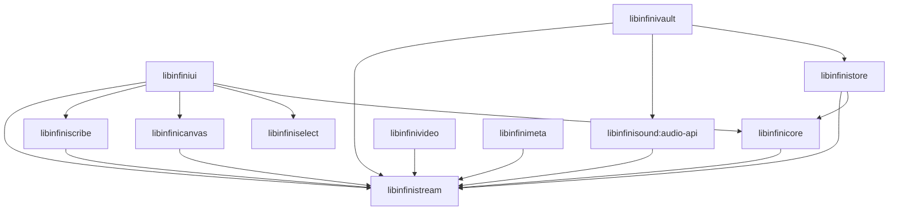

# InfiniSuite architecture

Each application has its own repository, manifest, application ID and build root.
Applications obtain pinned library sources inside their own checkout. No Gradle
build includes another application's source. Git commit locks and Gradle composite
substitution provide source builds without an unpublished Maven repository.

## Owners

| Component | Responsibility |
| --- | --- |
| Infinifolder | Browser UI, filesystem/storage integration and advanced storage composition |
| Infiniscribe | Document, ebook, font, source and legacy mind-map viewing/editing UI |
| Infinimedia | Audio/video player UI, queues, casting and visualizations |
| Infinikey | IME, input settings, layouts, voice/input helpers |
| libinfinistream | Portable streams, positional I/O and processing/capability contracts |
| libinfiniselect | Lightweight Android selection and ContentResolver boundary; no suite implementation dependency |
| libinfinicore | Resource/provider contracts, local/SAF adapters, guarded I/O/cache and generic support |
| libinfinistore | Advanced routing, remote clients, torrents, virtual locations and installed-app sources |
| libinfinivault | Archives, disk images, partitions and filesystem readers/writers |
| libinfinicanvas | Image decoding/processing and Android bitmap adapters |
| libinfiniscribe | Document/text parsing, rendering/editing backends and document resource expansion |
| libinfinisound | Audio formats, metadata, synthesis, decoding and PCM processing |
| libinfinivideo | Video contracts and platform playback/thumbnail adapters |
| libinfinimeta | Portable game/console/legacy-image metadata modules |
| libinfiniui | Shared Android UI/source adaptation and optional shared image viewer |

Existing package names are retained where practical. A `com.infinifolder.*`
package name in a library denotes source/API compatibility; it does not establish
an application dependency. Compilation from standalone library checkouts tests
that distinction.

## Library dependency graph

The sound library's `audio-api` carries portable contracts; Vault does not package
Sound's decoder/playback implementation. Likewise, linking `scribe-core` through
the shared UI does not include the Office/PDF/MOBI backends. Source repositories
can contain optional modules; Gradle compiles/packages the declared artifacts.

## Application dependency graph

```mermaid
graph TD
  Folder[Infinifolder] --> UI[libinfiniui:ui-image]
  Folder --> Select[libinfiniselect]
  Folder --> Store[libinfinistore]
  Folder --> Vault[libinfinivault]
  Folder --> Meta[libinfinimeta]
  Folder --> Scribe[libinfiniscribe:core/Android/MOBI thumbnail support]
  Folder --> Video[libinfinivideo:thumbnail extraction]
  Folder --> SoundAPI[libinfinisound:audio-api for raw inspection]
  Writer[Infiniscribe] --> UI
  Writer --> Select
  Writer --> ScribeFull[libinfiniscribe:document backends]
  Writer --> SoundCore[libinfinisound:audio-core for soundbank inspection]
  Media[Infinimedia] --> UICore[libinfiniui:ui-android]
  Media --> Select
  Media --> Sound[libinfinisound:audio-processing]
  Media --> Video
  Key[Infinikey] --> Android[AndroidX/Material/Gson only]
```

Follow the library graph above for transitive edges. Infiniscribe and Infinimedia
have no Store/Vault dependency. Infinikey has no InfiniSuite library dependency.
The icon theme is a source submodule owned by libinfiniui, rather than an app.

## Storage access

The selection library returns Android `content://` references and standard
single/multiple/document-tree results. Infinifolder exposes a standard
DocumentsProvider guarded by MANAGE_DOCUMENTS and Android URI grants. The
floating selector remains a compatible read-selection route. Writable and tree
requests use SAF, initially pointed at Infinifolder when its provider is present.
Without Infinifolder, the same Android facilities remain usable.

Native positional handles become proxy descriptors; sequential sources use
reliable pipes. Unsupported seeking remains explicit. Handles are owned by the
consumer until closed, and provider resources close when their descriptors or
streams are released. The boundary does not stage whole files to imitate random
access. Decoders/renderers can explicitly stage sources for APIs that require it.

The shared UI defaults to local/SAF resource adapters. Infinifolder installs its
advanced provider and archive consistency hooks before UI use. Shared libraries compile against
provider/callback contracts rather than application implementation types. Backend credentials and private
URI schemes remain behind Infinifolder's service.

See [storage validation](storage-validation.md) for the required runtime cases and
[the audit report](architecture-audit.md) for executed results and limitations.

## Asset ownership

Infinimedia owns the custom Infinimedia Default theme, the four original Winamp archives and the optional original SF3 bank. Only Infinimedia Default is packaged, generated deterministically from its theme directory. The older archives are compatibility fixtures in test-assets/skins, outside production assets. The bank lives in its `test-assets/soundfonts` with matching upstream license and provenance, outside APK source sets; current opt-in import behavior is preserved. The real archive/hash regression tests live in Media. The generic skin parser remains in shared UI with synthetic fixtures. Shared icon artwork remains in libinfiniui's pinned icon-theme submodule. Small generated codec fixtures remain with their owning processing libraries; storage integrity images remain with storage tests.

## Theme image boundary

Canvas owns format detection, image decoding, indexed IFF animation and direct
rendering of the Infini SVG palette extension. The shared UI owns skin archive
validation, logical sprite-to-image mappings, optional same-canvas layers, bounded
image caching and lifecycle animation scheduling. The Media application owns its
default theme choice, artwork, theme metadata and player-specific frame geometry.
The visual media pane combines VIDEO title artwork with GEN frame pieces; its
content remains an independent 16:9 stage.

`ImageAnimationPlayback` retains its package/API while moving from optional
ui-image into ui-android. Both image viewers and skin hosts use it, without making
Media depend on the full image-viewer screen. Existing explicit user theme choices
remain preferred; missing old bundled archives fall back to the configured default.
No storage library or application-to-application dependency was added.

See [theme rendering and verification](theme-rendering.md) for interfaces and
executed checks. The SVG-to-IFF authoring tool is documented [separately](svg-to-iff.md).

Indexed SVG playback now compiles flat paints to cached raster palette bindings in Canvas. An optional frame-interval hint keeps both image schedulers from adding a fixed delay after rendering. Still-only theme color sampling avoids animation setup. See the [measured performance correction](svg-cycle-performance.md) for ownership, tests and raster/gradient limitations; repository dependency edges are unchanged.
