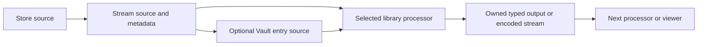

# Runtime capability discovery audit

> Repository layout updated 2026-11-11. Old host/module paths, build commands and
> test totals below record their original revision. For current owners and commands,
> use the [Android build guide](android-builds.md), [architecture](architecture.md)
> and [executed separation audit](architecture-audit.md).

Updated 2026-11-07. This change adds installed-handler discovery across all seven
libraries and the viewer components. It preserves existing decoders, public entry
points, MIME overrides, icon precedence, source safety and user settings.

## Findings and repair

No root, ancestor or applicable nested AGENTS.md was present when work began.
The audit covered the library settings/dependencies, existing parser/decoder APIs,
provider factories, MIME/magic resolution, viewer launches, image/audio/book icon
paths, Android intent generation and their regression suites. No library source
imports MainActivity or declares an app project dependency. The retained
`com.infinifolder.*` package names are compatibility names, not app dependencies.

The problem was composition: the host copied format lists, selected several
viewers/backends with fixed switches, and generated intent filters from those
copies. Library processing interfaces already existed, but there was no common
installed-handler catalog. Adding a decoder could therefore leave recognition,
launching, thumbnail eligibility and Android registration out of sync. Store also
listed unimplemented NFS/cloud choices alongside actual provider factories.

The repair introduces handler descriptors, typed services, cheap module-owned
ServiceLoader providers, scoped live registries and bounded source probing in
Stream. Each library registers executable adapters around its existing APIs.
Generic consumers now discover these adapters; compatibility facades remain.
Unsupported source/backend combinations fail or fall back instead of advertising
successful processing. Unimplemented storage choices are not returned as factories.

## Dependency graph

Cross-library composition is allowed and explicitly linked. A caller must declare
its dependency rather than assume an API happens to be installed. Gradle `api`
exposes dependencies used in public contracts, and `implementation` links private
backends. Standalone settings resolve sibling source builds with includeBuild;
missing required source repositories stop configuration with a useful error.

| Library | Infini dependencies | Executable discovery interface |
| --- | --- | --- |
| Stream | None; JVM only | CapabilityRegistry, RuntimeCapabilities, RuntimeProcessors |
| Store | Stream | StorageCapabilityHandler; actual bound StorageProvider probes |
| Vault | Stream, Store, Sound audio-api | ContainerCapabilityHandler; ArchiveReader dispatch |
| Sound | Stream through audio-api | PcmCapabilityHandler; AudioFileProcessor candidate selection |
| Canvas | Stream | ImageCapabilityHandler/ByteImageCapabilityHandler; CanvasStreams/ThumbnailDecoder |
| Scribe | Stream through scribe-core | ReadingCapabilityHandler, SpreadsheetCapabilityHandler, reparser/processor services |
| Video | Stream | VideoCapabilityHandler and VideoSurfacePlayback |

Third-party codecs/protocols remain declared in their owning Gradle modules.
The app and standalone hosts merge the common provider service resource. Shared
interfaces and registries are in libraries, not InfiniFolder's Activity. The plain
ViewerComponent contract is in Stream; viewer-common retains a compatibility alias
and an optional delegating Android adapter. Optional
modules are discovered only when packaged; native/class/codec availability is
reported independently of descriptive format hints.

## Interfaces, schema and registration

The canonical [Stream contract](../libraries/libinfinistream/CAPABILITIES.md)
documents fields, ordering, probing/ownership, callbacks, JSON schema and examples.
Every library also has its own CAPABILITIES.md, linked from its README, including
build commands, dependency declarations and format restrictions.

A module provides one or more public zero-argument CapabilityProviders and lists
them in `META-INF/services/io.github.gretchycat.infinistream.CapabilityProvider`.
Providers only construct descriptors/adapters. They must not connect, open source
content or initialize InfiniFolder. A handler has a stable ID, library, title,
format profiles (MIME/extension/scheme/magic), operations, metadata keys, limitations,
priority and extensible attributes. `describe()` supports delegated composites.

Queries distinguish identity from AVAILABLE/CONDITIONAL/UNAVAILABLE implementation
reports. Probes retain overlapping candidates and return confidence plus narrowed
operations. Exact MIME hints precede wildcards/suffix hints; content evidence is
separate from intentional user MIME/icon policies. Strong identityMagic or a real
registered Stream FormatProbe can identify new extensionless formats. Weak decoder
hints such as RIFF or ID3 never replace MIME identity by themselves. Recursion is
guarded when an identification plugin calls back into compatibility detection.

Selectorless services (for example raw-byte editing or general processor stages)
are enumerated by operation and checked through their typed input/port contracts.
An empty format match does not claim that a decoder recognizes arbitrary bytes.

Registrations and subscriptions are closeable. Registry revisions invalidate
in-process associations/viewer choices/icon results; stable descriptor fingerprints
also participate in persistent rendered-icon keys. Source revision, theme and user
registry keys remain separate. Availability refresh is explicit after configuration
changes; opening a decoder still validates the actual source.

## Format-module detection and metadata conformance

The shared [Stream capability contract](../libraries/libinfinistream/CAPABILITIES.md#format-module-validation-and-metadata-requirements) now requires each new format module to confirm content with bounded magic bytes or its actual structural parser. Extension/MIME matches remain candidates until content is checked. New handlers also expose bounded `MetadataCapabilityHandler.extractMetadata` results with source-derived fields and explicit partial/unavailable warnings; they must not fill unsupported fields with guesses. The conformance tests use real fixture inputs and include negative extension-only content. Existing decoder and viewer APIs remain the execution path.

`libinfinimeta` supplies generic source facts for every detected candidate and merges typed parser output when available. Format-specific metadata extraction is not yet migrated across all legacy handlers. The per-library test suites remain responsible for their existing parser metadata (for example, Canvas dimensions/EXIF, Sound stream properties/tags, Scribe text/document facts, and Vault entry structure); the common registry contract is the required path for newly added modules and incremental migrations.

## Processing is a series of streams and typed stages

`ProcessorCapabilityHandler` exposes an existing StreamProcessor and its
ProcessorRegistration negotiator. RuntimeProcessors collects these registrations
into the existing ProcessorRegistry. There is no second pipeline engine or copied
decoder. A real discovered chain, encoded bytes → Unicode text → table, is tested
without application initialization. Text and table facades use those same
negotiators; Canvas transform/PNG handlers expose theirs too. Typed image/text/table
outputs retain metadata and ownership without a redundant byte serialization.

A backend requiring positional access, complete input or a local file must say so.
Explicit, budgeted staging remains available; discovery does not silently spool.
Not every legacy backend exposes a negotiating StreamProcessor yet: PCM, archive,
video and document APIs retain their existing domain source/output contracts.
This change does not turn all processing into forward-only byte pipes or remove
existing safe publication/recovery rules.

## Real consumer paths

- MainActivity opens resources through ViewerComponents and ViewerLaunch. Registered
  viewer components point directly to their Activity and delegate format discovery
  to their content library. New component kinds need no MediaType enum member.
  Explicit queue/standalone choices still select the requested representation.
- EPUB/document and CSV viewers discover reading/spreadsheet services from Scribe;
  reparse backends come from their own modules. Video discovers its library backend.
  Image decode calls Canvas's registered handlers before compatibility fallback.
- IconPolicy remains authoritative for override/thumbnail ordering. The thumbnail
  slot can consume a registered EncodedImageExtractor and pipe its owned output to
  Canvas. Embedded audio extraction now uses that service; cache and directory-cover
  policy stay in the host. Registered thumbnail MIME types become editable icon
  records without replacing saved user fields. Existing book-cover specializations
  still call Scribe/Vault directly; they do not parse books in the UI.
- StorageRuntime is shared storage composition in storage-engine, not the browser
  Activity or a content decoder. It installs discovered factories, adds new types
  on registry changes, and binds the actual routing provider for resource probes.
  Protocol handlers can supply connection-field schemas and secure credential APIs;
  existing backend-specific wizards remain compatible.
- `viewer-*` modules are found by the build, linked into app/all-viewer host and
  self-register through services/manifests. `hex` is now a standalone selector.
- Android install-time filters are generated only from a JSON catalog exported
  from each app's actual dependency classpath. Providers execute without Android
  application startup; availability is explicitly NOT_EVALUATED in this build
  snapshot. Both AAR classes and Java resources enter the export classpath. The
  generated summary names every contributing handler and library. Vault's archive
  and disk/filesystem-image MIME/extension profiles and Store's `.iflink` MIME and
  extension association therefore enter Android registration from library data.
  Opening `.iflink` enters `LinkResolver` before viewer defaults are checked, then
  follows its target to a directory, internal viewer, app or external URI. Android reads
  these filters at package install/update time; the running app uses the same
  installed registry for recognition and dispatch.

Adding support means implementing/registering the proper typed handler/component
and linking its module. It does not require an InfiniFolder format switch, duplicate
registry or icon decoder. Publishing a new kind of presentation still includes its
own Android Activity/manifest and declared dependencies.

## Standalone audit and remaining limits

| Area | Audit result / retained restriction |
| --- | --- |
| App/UI dependencies | None from libinfini repositories; Android framework dependencies remain explicit Android modules. Viewers use shared storage composition and content libraries without starting MainActivity. |
| Format/protocol lists | Host recognition delegates to libraries. Android intent filters and the supported-types CSV use linked runtime capability descriptors; historical MIME seeds remain compatibility/presentation data. |
| Legacy handler granularity | Canvas legacy/platform formats, Sound legacy formats and Vault parsers retain grouped compatibility handlers. These report CONDITIONAL and parser-specific limitations; they do not claim every variant or native dependency succeeds. Further splitting can use the same registry. |
| Optional dependencies | Portable JAAD/JLayer classes, Android audio codec list and optional native symbols/ABI are checked; missing implementations are unavailable. SoundFont/source/codec and libVLC surface constraints remain per-open checks. |
| Read/write | General Vault discovery offers reads/list/extract, not universal writes. Actual provider flags and input metadata restrict mutation. Read-only Office documents are not promoted to CSV editors. |
| Overlaps | All handler candidates survive discovery; deterministic ordering chooses a first consumer candidate. Pipeline registrations sharing a processor ID select the first available registration, not conflicting duplicates. |
| Probe bounds | Shared bounded prefix; failed inputs are not reopened per handler. Cancellation/time limits are cooperative and cannot interrupt a blocking transport call without its own timeout. Non-reopenable inputs need an explicit replay owner. |
| Handler withdrawal | Future queries stop seeing the handler; existing provider graphs/open leases remain alive. No downloaded code installation or unsafe hot unloading. |
| Platforms | Portable JVM APIs/tests are independent. Android Bitmap, surfaces, SAF grants, native playback and network credentials require device/runtime validation. |
| Build bridge | Catalog export uses the pinned AGP artifact views for AAR classes and Java resources. Recheck the adapter on AGP upgrades; this does not run codecs at build time. |

## Verification

The full gate run on 2026-11-04 passed **1,071 cases, 0 failures/errors/skips** across 157 suites.
The migration-baseline comparison reports **0 regressions and 0 missing cases**;
all 30 previously repaired baseline failures remain passing. Eighteen new capability
cases exercise real transformations, PCM, XML, tables, pixel parsing, nested ZIPs,
new container registration and viewer-to-library calls. Android stub tests do not
establish rendered UI acceptance.

| Standalone command (from repository root) | Result |
| --- | --- |
| `gradle -p libraries/libinfinistream :stream-core:test :stream-core:assemble --offline` | Passed; 40 cases |
| `gradle -p libraries/libinfiniscribe :scribe-core:test :scribe-reparse-api:test :scribe-reparse-xml:test :scribe-reparse-yaml:test :scribe-reparse-toml:test :scribe-office:test :scribe-rtf:test :scribe-android:testDebugUnitTest :scribe-mobi-android:testDebugUnitTest :scribe-reparse-json-android:testDebugUnitTest :scribe-android:assembleDebug :scribe-mobi-android:assembleDebug :scribe-reparse-json-android:assembleDebug --offline` | Passed; 154 cases plus Android AAR builds |
| `gradle -p libraries/libinfinisound :audio-api:test :audio-core:test :audio-guitarpro:test :audio-processing:testDebugUnitTest :audio-processing:assembleDebug --offline` | Passed; 109 cases plus Android AAR |
| `gradle -p libraries/libinfinicanvas :canvas-android:testDebugUnitTest :canvas-android:assembleDebug --offline` | Passed; 90 cases plus AAR |
| `gradle -p libraries/libinfinistore :store-android:testDebugUnitTest :store-android:assembleDebug --offline` | Passed; 15 cases plus AAR |
| `gradle -p libraries/libinfinivault :vault-android:testDebugUnitTest :vault-android:assembleDebug --offline` | Passed; 11 cases plus AAR |
| `gradle -p libraries/libinfinivideo :video-api:test :video-android:testDebugUnitTest :video-android:assembleDebug --offline` | Passed; 31 cases plus AAR |
| `gradle :app:assembleDebug :viewer-host:assembleDebug testDebugUnitTest -Pviewer=all --offline` | Passed; both APKs and 621 host/viewer/storage cases |

The final host pass is incremental (589 tasks, 3 executed, 586 up-to-date); preceding
runs compiled the changed sources and ran the affected suites. Modules with no
runnable JVM cases are not counted as tests: Android/native display, Office/MOBI/RTF
backends and several viewer surfaces have compile/package evidence and still need
appropriate runtime checks.

Both APKs contain all **29 expected provider registrations** and the shared Stream
ViewerComponent contract in DEX. The app's exported build catalog has **65 handler
records**, no registration failures, and explicit NOT_EVALUATED availability.
This validates classpath registration/packaging, not Android UI execution. The
[validation record](validation/runtime-capabilities-2026-11-04.json) contains commands,
intermediate failures, final results, per-module totals, new case names, library
commit pins and APK SHA-256 values.

### Focused follow-up — 2026-11-07

These suites and build were rerun after the text-by-content and playlist changes.
They are focused follow-up results and do not replace the full cross-library gate
above.

| Command | Result |
| --- | --- |
| `cd libraries/libinfiniscribe && gradle :scribe-core:test --no-daemon --console=plain` | Passed, including unknown-extension, extensionless, CP437, BOM Unicode and binary-rejection probes |
| `cd infiniscribe && gradle assembleDebug --no-daemon --console=plain` | Passed; standalone APK and runtime-derived intent catalog generated |
| `cd libraries/libinfinisound && gradle :audio-api:test --no-daemon --console=plain` | Passed, including playlist capability and metadata tests |
| `gradle :viewer-audio:testDebugUnitTest --no-daemon --console=plain` | Passed, including six-track XSPF/JSPF expansion and viewer routing |
| `cd libraries/libinfinimeta && gradle :meta-core:test :meta-sega:test --no-daemon --console=plain` | Passed, including parser metadata preservation and Sega ROM/disc fixtures |

### Failures found during the gate

- Removed format lists left one static manifest-inventory lookup pointing at the
  host class. It now reads library-owned facts; the catalog supplements those
  compatibility associations from the actual packaged dependency graph.
- The common classifier test lacked a linked Video implementation after its copied
  extension list was removed. Its runtime test dependency is now explicit.
- An audio integration test required an unavailable Android decoder to fail during
  processing. It now verifies runtime exclusion and still checks actual decoded
  PCM rate, channels, duration, RIFF output and signal amplitude.
- Markdown had only an Android test helper and no runnable test, which Gradle 9.7
  rejects. Its new integration test discovers the real component, decodes through
  Scribe and renders actual Markdown HTML. No empty-suite suppression was added.
- Initial standalone AAR assembly lacked cached lint-gradle 31.9.2. One online
  Canvas assemble fetched the dependency and passed; subsequent independent AAR
  builds passed offline. Existing AGP/Gradle deprecation and native AAPT warnings
  remain; no release-shrinker execution is claimed.

### Still unverified

ADB reports no connected device. Icon/viewer/editor display, gestures, Android
launch/long-press behavior, live SAF grants and remote credentials, and device
native/audio/video playback are unverified for this increment. Previously confirmed
handset workflows remain historical acceptance, not new runtime-discovery evidence.
The regenerated [audio fixture report](audio-playback-authoritative-report.md) is
also JVM-only: 47/76 audio fixtures decode, 29 remain unavailable/unsupported there,
and two playlists parse. It does not establish device codec availability.
